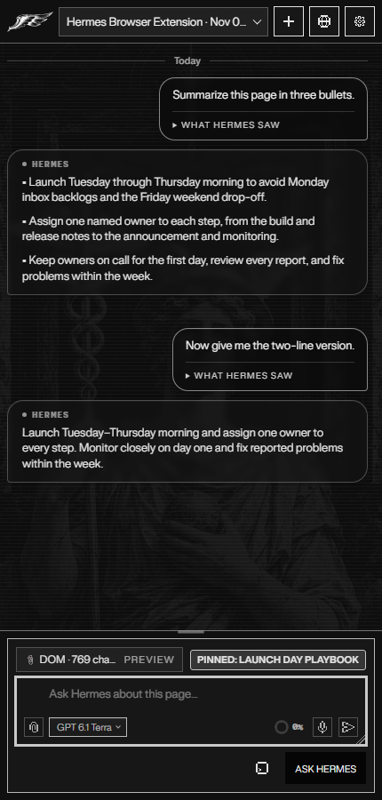
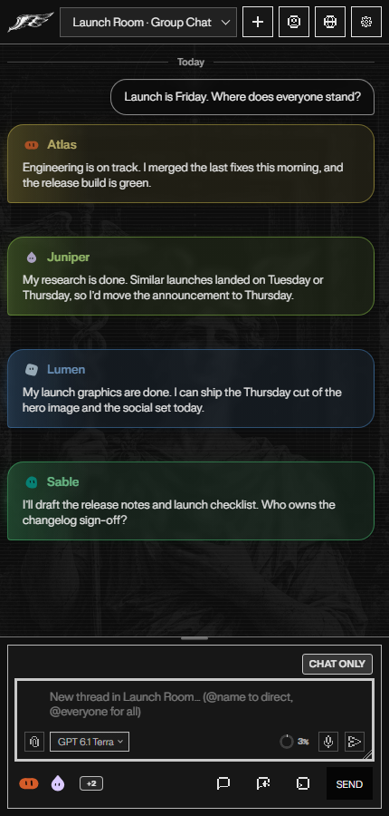
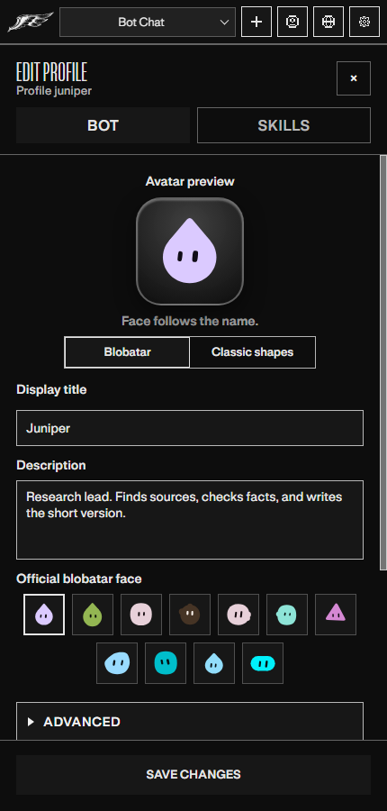
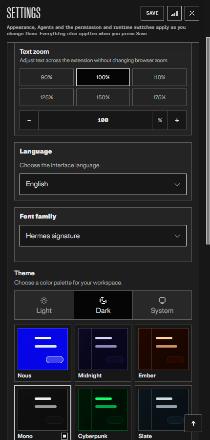
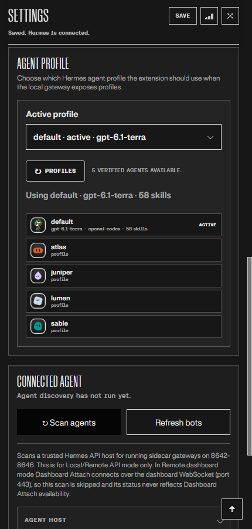
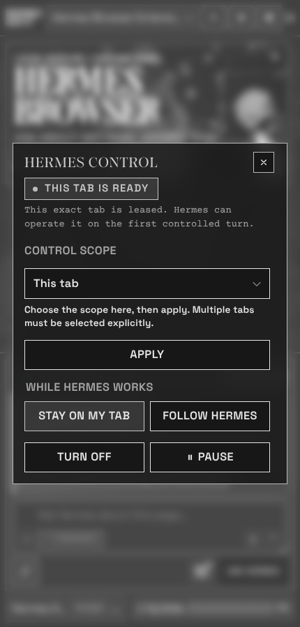

# Hermes Browser Extension

Browser-native side panel for [Hermes Agent](https://hermes-agent.nousresearch.com/docs) — connect active web context through a local gateway, Hermes Cloud, or a self-hosted remote gateway.

> Created by **Jon Komet** (`@abundantbeing`). Community extension for [Hermes Agent](https://github.com/NousResearch/hermes-agent) by [Nous Research](https://nousresearch.com). MIT licensed.

<p align="center">
  
</p>

<p align="center">
  <strong>v0.4.1 · Chromium and Firefox · Local / Hermes Cloud / Remote · Full Hermes runtime tools</strong>
</p>

<p align="center">
  <a href="https://github.com/abundantbeing/hermes-browser-extension/releases/latest"></a>
  <a href="https://addons.mozilla.org/firefox/addon/hermes-browser-extension/"></a>
  <a href="./LICENSE"></a>
  <a href="https://github.com/NousResearch/hermes-agent"></a>
  <a href="https://nousresearch.com"></a>
  <a href="https://github.com/abundantbeing/hermes-browser-extension/stargazers"></a>
</p>

<p align="center">
  
  
  
  
  
  
  
  
</p>

<p align="center">
  <a href="https://ko-fi.com/T8Z726J5YZ"></a>
</p>

## What it is

Hermes Browser Extension is not a browser chatbot. It is a Chromium side panel or Firefox sidebar for the real Hermes Agent runtime. Hermes Control is complete on Chromium and restricted on Firefox, where it can read pages, open addresses and manage tabs but cannot click or type ([what works on Firefox](./guides/firefox.md)). Choose a local gateway, attach to a signed-in Hermes Cloud agent tab, or connect to a self-hosted remote API/dashboard. Local and remote API connections can use the models, tools, skills, sessions, memory, and MCP servers already configured in Hermes; Cloud and dashboard-ticket connections are intentionally Chat-only.

- **Bot Mode** brings your Hermes agent roster into the panel: switch agents, edit profiles, and run group chats where several agents reply in one room. **Current group-chat limitation:** page-context delivery is not yet reliable; do not assume group bots can see the active page. Hermes Control is not shown in group chats. Individual bot chats retain their existing page-context and control behavior. Chat-only and remote group turns do not capture page context.
- **File attachments** show one card per file per message. Open previews the file, Open on computer reveals the original file's containing folder through local Hermes, and Save downloads a copy.
- **Tab screenshot** stages the visible, approved page as an image attachment when you choose it from the attachment menu. Screenshots are never captured automatically.
- **Hermes Control** sets which tabs Hermes may operate: This tab, Selected tabs, or a Task set of tabs you pick explicitly.
- **Live sessions**: running chats are highlighted in Sessions. On gateways that expose live sessions, reopen a working chat to follow its reply and tool activity. Supported live sessions offer Steer, Queue, and Stop instead of idle send controls, and steers sent from another client appear in the followed transcript. On gateways with session authority, chats running in the CLI, Desktop or another window are listed too, and Stop is aimed at the run it was started for.
- **Projects**: on a dashboard connection to a gateway with session authority, the sessions drawer has a Recents | Projects strip. List projects, open one, start a session in its folder, create a project from a folder path on the machine running Hermes, or move a session to another project or folder. Where the gateway cannot do this, the tab says why and Recents keeps working.
- **Response style and chat layout**: Vivid UI (cards, tables and charts when they help), Rich text or Plain text, with bubbles on both sides or for your messages only. First-time setup walks through theme, font, style and layout, and ends with Connect to Hermes. Settings > Appearance & Themes can run it again. See [guides/haui-v1.md](./guides/haui-v1.md).
- **Context**: each session's own context window, read from the gateway, with a ring in the composer. On gateways with session authority, Compact context replaces older messages with a summary and reads the session back before it says it worked.
- **Capability states**: Settings > About & Diagnostics shows what this connection can do (available, cached, unsupported and so on), with the reason, source and age, and the support report prints the same rows.
- **Tool activity**: a compact expandable list keeps calls out of the reply. Inspect individual calls, close the list without hiding thinking, and keep your place while activity updates.
- **Message tools**: Copy, Edit, and Restore checkpoint on supported turns, with day dividers, message times, and theme-aware bubbles. History refreshes keep the current question in place when Hermes merges older and newer turns, without hiding genuine repeated messages.
- **Reasoning effort**: a slider with tick marks, or buttons if you prefer. The choice is remembered. In a group chat each bot keeps its own effort.
- **Hermes Assist** drafts beside supported text composers and never sends, posts, or submits for you. Its button beside a writing field carries the icon you pick in Settings > Hermes Assist (the wing, the staff or the Nous girl) and follows the page's light or dark theme.
- **Read aloud**: every finished reply has a speaker button beside Copy that reads the answer only, and only when you press it. It uses your Hermes profile's voice when the dashboard is reachable on this computer, and the browser's own voice otherwise.
- **Saved connections**: keep several gateways under Settings > Connections and switch between them from cards.
- **Page comments**: pick an element, write a note, and queue pins beside Ask Hermes.
- **Settings**: a category home opens one section at a time, with Back navigation, edited-category markers, and direct links from related controls.
- **Appearance**: Light, Dark, or System mode, twelve themes, text zoom, and a font list. Everforest has forest greens and warm parchment; Classic Hermes has amber gold and navy; Anti-Nous has crimson, navy reading panels, and fine gold trim. Nous Light keeps its white shell and Nous Blue accents. Centered background artwork changes when you open the panel and scales with its width; sidecar illustrations rotate independently.


The full list of changes per version lives in the [changelog](./CHANGELOG.md) and the [releases](https://github.com/abundantbeing/hermes-browser-extension/releases).

## Visual tour

Screenshots use the Mono theme in Dark mode.

| Side panel | Bot chats | Edit a bot |
| --- | --- | --- |
|  |  |  |
| Theme settings | Local agents | Hermes Control |
|  |  |  |

## Requirements

- Hermes Agent installed and working, with its API server key set (`API_SERVER_KEY`, 16 or more characters). Hermes Cloud instead needs a signed-in HTTPS agent tab.
- Chrome, Edge, Brave, Comet, or another Chromium browser with Side Panel API support (Chrome 116+), or Firefox 142+ from [AMO](https://addons.mozilla.org/firefox/addon/hermes-browser-extension/), the Mozilla Add-ons listing.
- Node.js 20+ to build the Chromium extension from source. `npm run build:firefox` is for local/dev Firefox builds only.
- For Hermes Control on current Hermes: the extension's Hermes plugin (one command, below).

## Firefox scope

Hermes Browser Extension on Firefox is a chat-and-context client with a restricted Hermes Control: pairing, the sidebar (declared with `sidebar_action`, not the Chromium side panel), streaming replies, attachments, and page-context capture all work, and Hermes Control can read the page, open addresses, scroll, take a screenshot you allow, and list, open, switch and close tabs. Firefox has no equivalent to Chromium's `debugger` API, so the Firefox package omits that permission, and that means no trusted input (no clicks, typing or key presses) and no control of controls inside frames on Firefox. Hermes Control says so when it is asked for one of those, and Settings > About & Diagnostics lists every Firefox limit before you start a task. The newer panel screens (first-time setup, Projects, capability states, Compact context) use no Chromium-only API, but they were not exercised in the Firefox sidebar for this release.

If you need Hermes to click or type on your behalf, load the extension in Chrome, Edge, Brave, or another Chromium browser. [guides/firefox.md](./guides/firefox.md) has the table of what is supported, limited, experimental and unavailable on each surface, and why; the general compatibility matrix is in [guides/connection-guide.md](./guides/connection-guide.md).

## Hermes Control

Hermes Control lets Hermes operate a tab you attach. It is opt-in and off until you turn it on. It is complete on Chromium; Firefox has a restricted version (no clicks, typing or frame control, see [guides/firefox.md](./guides/firefox.md)).

- **Current Hermes needs the extension's Hermes plugin for it.** Hermes 0.22.5 and earlier carry Hermes Control themselves. Hermes builds from October 24, 2026 on (canary, and every release after 0.22.5) get it from the `hermes-browser-extension` plugin: run `hermes plugins install https://github.com/abundantbeing/hermes-browser-extension.git#companion-plugin --enable` (add `--profile <name>` per bot) and restart the gateway. [companion-plugin/README.md](./companion-plugin/README.md) lists everything it needs.
- **Several tabs at once.** Hermes can list the tabs it may use, open pages in new background tabs, act in any of them by tab id without changing what you are looking at, close tabs (after asking you), and group the ones it opened. A link Hermes clicks that opens a new tab becomes a tab it can use, and every result says which tab it ran in.
- **Background task tabs (opt in, Chromium).** Turn it on under Settings > Permissions & Control and a chat on your local Hermes gateway, including one from a messaging app, can open and work in its own tab group without you attaching a tab. It never touches your other tabs, and turning it off stops control. It needs the Hermes plugin at 0.4.1 or later.
- **The attached tab is announced to the model.** Each turn tells Hermes the tab is ready and lists its interactive elements with refs, so the first click works without a separate snapshot or navigate step.
- **Every action returns the updated page.** Click, type, scroll, and navigate give back a compact, redacted view of the page with fresh refs, so Hermes can chain steps.
- **One debugger session per attached tab.** Chrome shows its debugging banner while a tab is attached. The session detaches when you detach the tab, pause or turn off control, or after 60 seconds without a command.
- **Approvals still gate risky actions.** Consequential or privileged actions wait for your approval, and restricted pages and sensitive fields stay blocked.
- **Frames are read and judged again at action time.** Hermes can reach controls inside same-site frames of an attached page, such as a live chat box. A frame on a restricted page is never read, and a click, type or hover is refused if the frame it would land in has moved to a restricted address since the page was read or is covered by one. Frames from another site, which Chrome runs in their own process, are not read or acted on.

## Quick start

There are four steps. Step 1 happens on the machine that runs Hermes; the rest happen in your browser. If Hermes runs anywhere other than this computer, follow [guides/connection-guide.md](./guides/connection-guide.md) for the address to use. That covers another machine, WSL, Docker, Tailscale, an SSH tunnel, a reverse proxy and named profiles.

### 1. Give Hermes an API key

Hermes serves the API the extension talks to once `API_SERVER_KEY` is set. It refuses a key shorter than 16 characters, even on `127.0.0.1`.

```bash
hermes config set API_SERVER_KEY "$(openssl rand -hex 32)"
hermes gateway restart
curl http://127.0.0.1:8642/health
```

- The first line saves a new random key. Instead, you can add `API_SERVER_KEY=<32+ random characters>` to the Hermes `.env` yourself; `hermes config env-path` shows where that file is.
- The second line restarts the gateway. Use `hermes gateway run` instead if you run it in the foreground.
- The `curl` line should answer with a small JSON status.

Keep the key: you paste it into the extension in step 3.

On Windows:
- PowerShell has no `openssl`. The [connection guide](./guides/connection-guide.md#step-1-give-hermes-an-api-key) has a PowerShell line that makes a key.
- `Copy_Hermes_Browser_API_Key.cmd` in this repository copies the saved key to the clipboard.

You do not need to add the extension to `API_SERVER_CORS_ORIGINS`. Hermes refuses requests that carry an `Origin` header it doesn't list, and the extension removes that header from its own requests to your gateway.

### 2. Install the extension

**Chrome, Edge, Brave, Comet**

```bash
git clone https://github.com/abundantbeing/hermes-browser-extension.git
cd hermes-browser-extension
npm install
npm run build
```

1. Open `chrome://extensions` (or `edge://extensions`, `brave://extensions`).
2. Turn on **Developer mode**.
3. Click **Load unpacked** and select this repo's `dist/` folder: not the repo root and not `extension/`.
4. Pin the Hermes icon and click it (or press Alt+H) to open the side panel.

On Windows, `Setup_Hermes_Browser_Extension.cmd --clip` builds the extension, opens your default browser's extensions page and copies your Hermes key to the clipboard (without `--clip` it does not touch the clipboard).

After pulling updates, run `npm run build` again and click **Reload** on the Hermes Browser Extension card.

**Firefox**

1. Open [AMO](https://addons.mozilla.org/firefox/addon/hermes-browser-extension/) in Firefox.
2. Click **Add to Firefox** and confirm the permission prompt.
3. The extension opens in the Firefox sidebar (Ctrl+Shift+H).

AMO delivers signed updates automatically. Do not sideload the GitHub source zip or tar.gz: those are source archives, not a Firefox add-on.

The Firefox add-on 0.4.1 still sends the `Origin` header. If its first message is refused with a 403, add the origin the panel names to `API_SERVER_CORS_ORIGINS`; see [If a message is refused with a 403](./guides/connection-guide.md#if-a-message-is-refused-with-a-403).

### 3. Connect

1. In the side panel, finish first-time setup and choose **Manual setup** on its last step. Later, use **Settings > Connections > Add**.
2. Choose **Local gateway** (this computer), enter `http://127.0.0.1:8642` and paste the key from step 1.
3. Click **Test connection**, then **Save settings**.
4. Open a normal `https://` page and ask: `Summarize this page in one sentence.`

The one-click **Connect to Hermes** button uses automatic pairing, which needs pairing routes that stock Hermes does not ship. On stock Hermes it tells you to use Manual setup, which is the path above.

### 4. Optional: let Hermes operate your tabs

Chat, page context, sessions, models and attachments work now. Two features need the extension's Hermes plugin:
- **Hermes Control**: Hermes clicking, typing and working in tabs you attach.
- **Background task tabs**.

Install the plugin on the machine that runs Hermes, then restart the gateway. For a named bot, add `-p <profile>` before `plugins`.

```bash
hermes plugins install hermes-browser-extension --enable
hermes gateway restart
```

Then turn Hermes Control on under **Settings > Permissions & Control**. [companion-plugin/README.md](./companion-plugin/README.md) lists what the plugin needs and how to get its newest version.

### Using an AI agent to set this up

Point your agent at this repository and ask it to set the extension up for you. [guides/agent-setup.md](./guides/agent-setup.md) has the exact steps it should follow, including which ones only you can do in the browser.

## Connect to Hermes

Settings offers the same three connection choices as Hermes Desktop:

| Connection mode | Use it for | Transport and boundary |
| --- | --- | --- |
| **Local gateway** | Hermes running on this machine (including WSL2 and Docker with a published port), or another machine reached through an SSH tunnel | Local API server, default `http://127.0.0.1:8642`, with `API_SERVER_KEY`. |
| **Hermes Cloud** | A signed-in Hermes Cloud agent open in a normal browser tab | Trusted Dashboard Attach mints a short-lived, single-use WebSocket ticket from the active HTTPS agent tab. Chat-only; no page text, selected text, open-tab context, or attachments are sent. |
| **Remote gateway** | A self-hosted Hermes on another machine: Tailscale, a LAN or VPN, or an HTTPS reverse proxy | With a key: remote API server. Without a key: signed-in HTTPS dashboard ticket/WebSocket. Hermes Control needs an `https://` address here; plain `http://` to another machine is chat only. |

[guides/connection-guide.md](./guides/connection-guide.md) has the exact setup for each place Hermes can run:
- this computer, WSL2 or Docker;
- a VPS over Tailscale or an SSH tunnel;
- another computer on your network;
- an HTTPS reverse proxy;
- named profiles;
- Hermes Cloud, or a dashboard-only Hermes.

Existing installations migrate automatically:
- Earlier `local-api` settings become Local gateway.
- Earlier `remote-api` and `remote-dashboard` settings stay Remote gateway.
- A legacy remote dashboard is never silently relabeled as Hermes Cloud.

### Saved connections

**Settings > Connections** lists your saved connections as cards that show each one's kind and address. Select a card to switch.

- **Add** walks you through a new connection:
  - where it is: this computer, a remote gateway or Hermes Cloud;
  - how you sign in: the browser, or an API key;
  - its options: custom headers for a gateway behind an authenticating proxy, and a note for a gateway with its own certificate.

  The connection is tested before it is added. If the test fails, you can try again, open the address in a tab to accept its certificate, or add it untested.
- **Options** changes the headers and the certificate note of the connection you are using.
- **Rename** opens a name field in place.
- **Delete** opens a window that lists your connections, so you choose which one to remove, and says what it removes.

Custom headers go with every request the extension makes to that address, streamed replies included, and to nothing else. A browser cannot put headers on the dashboard's live WebSocket connection.

A private network needs nothing special. Start Tailscale or WireGuard first, then add a Remote gateway at the address it gives you, with your API key. An SSH tunnel is a port on this computer, so add it as a Local gateway at `http://127.0.0.1:<tunnel port>`. An extension cannot open an SSH session itself. **Local gateway** also discovers Hermes dashboards on this computer: stop the local Hermes gateway before you connect through a tunnel to a remote machine, or bots from both can mix.

Each entry keeps its own gateway address, API key and dashboard settings in browser-local storage. Your existing setup becomes the first entry. Only one saved connection is active at a time. Switching:
- saves the current settings and closes the old connection;
- reloads the panel with a fresh chat on the selected gateway.

Earlier conversations stay in that gateway's session list. Turn Hermes Control on again when you need it on the new connection.

Do **not** expose the Hermes API server naked to the public internet: it runs the real Hermes, with its tools. Keep it on `127.0.0.1` and reach it through Tailscale, an SSH tunnel or an HTTPS reverse proxy.

## Security model

Hermes Browser Extension is intentionally conservative:

- Local gateway by default; remote API server support requires an explicit URL, token, and CORS allowlist.
- Hermes Cloud and self-hosted dashboard attach require an explicit HTTPS origin, the exact active signed-in tab, and a short-lived single-use WebSocket ticket kept only in memory.
- Cloud/dashboard-ticket connections are Chat-only and cannot send browser page text, selected text, open-tab context, or attachments.
- Strong bearer/API key required for API access.
- Page content is wrapped as untrusted context before it reaches Hermes.
- Credential-bearing URLs are omitted from active, selected, open-tab, pinned-scope, prompt, receipt, and payload-hash surfaces.
- Page context capture is read-only. Page control exists only through opt-in Hermes Control (complete on Chromium, restricted on Firefox), which acts on tabs you attach and pauses risky actions for approval. Hermes Assist may insert a reviewed draft into a supported focused composer only after an explicit user action; it never clicks Send/Post/Submit, navigates, checks out, or performs browser-control workflows.
- Chromium builds request `debugger` for opt-in Hermes Control; Firefox builds omit it. No `nativeMessaging`, `cookies`, `history`, or `bookmarks` permissions. `downloads` is limited to explicit user-requested generated-image/artifact saves.
- Restricted pages include browser internals, extension pages, and obvious banking/crypto/password/payment/health/government-tax categories.

See [`SECURITY.md`](SECURITY.md), [`PERMISSIONS.md`](PERMISSIONS.md), [`DATA-FLOW.md`](DATA-FLOW.md), and [`PRIVACY.md`](PRIVACY.md) for details.

## Troubleshooting

Tools available to the agent come from your Hermes setup. See the [Hermes docs](https://hermes-agent.nousresearch.com/docs).

### I loaded the extension but nothing works

Make sure you loaded `dist/`, not the repo root. The selected folder must contain `manifest.json` directly.

### Chrome still shows an older version after updating

The browser is still using an old unpacked folder or an unpacked extension card that was not reloaded. For v0.4.1, the source manifest, built `dist/` manifest, and release archive should all contain `manifest.json` version `0.4.1`.

Fix:

1. Extract/download the v0.4.1 release or run `npm run build` locally.
2. Open `chrome://extensions` or `edge://extensions`.
3. On the Hermes Browser Extension card, click **Reload**.
4. If it still shows an older version, click **Remove**, then **Load unpacked** again and select the fresh v0.4.1 `dist/` folder.
5. Click **service worker** / **Inspect views** only for debugging; it is not the version source.

### Skills or profiles do not load

Startup shows Skills and Profiles separately. A current Hermes connection can load profiles and skills through its API routes when no dashboard is available. Older connections keep the dashboard path, and a missing route preserves the last loaded details instead of clearing them. A connected gateway does not guarantee that every catalog route is available, and each route is advertised on its own.

Images attached earlier in a session load again when the gateway serves its stored files. On a gateway that does not, the panel keeps the previews it still has and shows the file names for the rest.

After the Hermes backend is responding again, reopen the panel or use **Test connection** to retry. Existing skills and profiles are not deleted by a catalog timeout.

### Voice dictation records but no text appears

Hermes transcription needs an advertised API transcription route or a reachable dashboard transcription route. If neither is available, the panel uses browser speech when that browser supports it. A slow or unavailable browser speech download now falls through instead of leaving the click waiting, but browser speech itself depends on the browser.

### A reply is not read aloud

The speaker button beside Copy reads the finished reply aloud when you press it. With the Hermes dashboard reachable on this computer it uses your Hermes profile's own voice (the `tts` setting of that profile) through the dashboard's `/api/audio/speak` route; otherwise it uses the browser's speech voices, which are the ones your operating system offers. Settings → About & Diagnostics shows a **Voice (read aloud)** row naming the route in use: Gateway TTS, Browser speech or None. If Hermes has no voice set up or cannot make the audio, that row says the last read fell back to the browser's voice and gives Hermes' reason.

### Filing a support issue

Open Settings → **Support diagnostics** → **Copy Diagnostics** and paste the report into the GitHub issue or support thread.

The copied block includes version/build, browser family, gateway origin, connection state, each capability's state, source, age and reason, selected model/provider, context mode, extractor mode, last visible error, and a bounded gateway failure classification when available. It intentionally excludes API keys, bearer tokens, cookies, page text, selected text, tab titles, raw tracebacks, local paths, and full tab URLs.

### The side panel says it cannot connect

[guides/troubleshooting.md](./guides/troubleshooting.md#cannot-connect) lists each connection message and its fix. Start with these two checks on the machine that runs Hermes:

```bash
curl http://127.0.0.1:8642/health
curl -H "Authorization: Bearer <API_SERVER_KEY>" http://127.0.0.1:8642/v1/models
```

- **The first command gets no answer:** the gateway or its API server is not running. Set `API_SERVER_KEY` (16 or more characters), restart the gateway, and check the address and port.
- **The second command returns 401:** the key does not match. Paste the key from the Hermes `.env` into the extension again; `hermes config env-path` shows where that file is. For a named profile, use the listener key from the default `.env` and keep every profile's key aligned with it (see [named profiles](./guides/connection-guide.md#several-hermes-bots-named-profiles)).
- **A message is refused with a 403 and no error body:** your browser sent the `Origin` header Hermes refuses. Add the origin the panel names to `API_SERVER_CORS_ORIGINS` and restart the gateway.

Sometimes the browser only reports a failed fetch. It then cannot tell whether the gateway refused the connection, blocked the request, or received the message before the response was lost. The side panel keeps your draft and offers **Check connection**, and it never resends on its own. Check the session history before you send again: a lost response can hide a message that did arrive, and sending it twice would duplicate the turn.

More troubleshooting, including runtime warnings and native Hermes computer use, is in [guides/troubleshooting.md](./guides/troubleshooting.md).

## Development

```bash
npm test
npm run check:js
npm run check:manifest
npm run verify
npm run build
npm run package
```

```text
extension/          MV3 source: sidepanel, background worker, content scripts, lib/
companion-plugin/   the Hermes plugin (hermes-browser-extension): Hermes Control on current Hermes, browser-context tools and hooks (see its README.md and install.md)
scripts/            build, Firefox packaging, manifest checks
tests/              node:test suite
dist/               generated unpacked build (load this one)
```

## Relationship to Hermes Agent

[Hermes Agent](https://github.com/NousResearch/hermes-agent) is an open-source project by Nous Research. Hermes Browser Extension is a community extension by Jon Komet that connects through a local gateway, Hermes Cloud agent tab, or self-hosted remote gateway. It is designed to live at the edge of the ecosystem without adding core tool-schema footprint.

Useful links:

- Hermes docs: <https://hermes-agent.nousresearch.com/docs>
- Hermes API server docs: <https://hermes-agent.nousresearch.com/docs/user-guide/features/api-server>
- Hermes upstream repo: <https://github.com/NousResearch/hermes-agent>

## Star History

<a href="https://www.star-history.com/?repos=abundantbeing%2Fhermes-browser-extension&type=timeline&legend=bottom-right">
 <picture>
   <source media="(prefers-color-scheme: dark)" srcset="https://api.star-history.com/chart?repos=abundantbeing%2Fhermes-browser-extension&type=timeline&theme=dark&legend=bottom-right&sealed_token=GF2Z0Dz8jAbfQ0SpqcdyUM458IUVYJKcy5MvICCmRG32E-UfAG6Ifb8GTV6LXCDIhyY0J5WPOLlIKbSrn1F9Me-7Zrpt3XoN-eFEkORrH9Kg6WT433Gtug" />
   <source media="(prefers-color-scheme: light)" srcset="https://api.star-history.com/chart?repos=abundantbeing%2Fhermes-browser-extension&type=timeline&legend=bottom-right&sealed_token=GF2Z0Dz8jAbfQ0SpqcdyUM458IUVYJKcy5MvICCmRG32E-UfAG6Ifb8GTV6LXCDIhyY0J5WPOLlIKbSrn1F9Me-7Zrpt3XoN-eFEkORrH9Kg6WT433Gtug" />
   
 </picture>
</a>

## Contributors

External contributions that have shipped are credited in [`CONTRIBUTORS.md`](CONTRIBUTORS.md). Interface icons are [pixelarticons](https://github.com/halfmage/pixelarticons) (MIT); its licence ships in `extension/assets/icons/pixel/`. **Rules** signature typefaces (Blaze Type) ship under Nous Research's commercial license; see [`extension/assets/fonts/README.md`](extension/assets/fonts/README.md).

## Author

Built by **Jon Komet** (`@abundantbeing`). If this extension saves you time, [support the work on Ko-fi](https://ko-fi.com/T8Z726J5YZ).

## License

MIT. See [`LICENSE`](LICENSE).
